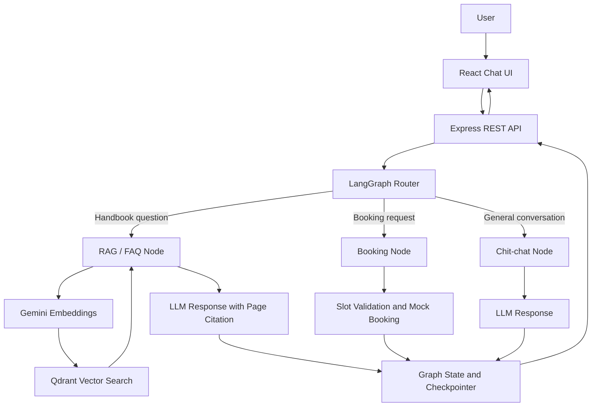

# Agentic HR Assistant

A conversational HR assistant that combines **Retrieval-Augmented Generation (RAG)** with a stateful appointment-booking workflow. Users can ask questions about an employee handbook, book a performance review session, and interrupt a booking conversation to ask a policy question before continuing the booking.

## Features

- **Employee Handbook Q&A:** Retrieves relevant content from a PDF handbook and generates answers with page citations.
- **RAG Pipeline:** Extracts PDF text, splits it into overlapping chunks, creates embeddings, and stores vectors in Qdrant.
- **Stateful Agent Workflow:** Uses LangGraph `StateGraph`, routing logic, conditional edges, and a `MemorySaver` checkpointer.
- **Multi-turn Booking:** Collects the user's name, email, and preferred appointment slot.
- **Context Switching:** Allows users to ask handbook questions during an active booking and resume the pending booking afterward.
- **React Chat Interface:** Displays conversation messages, thread ID, booking information, and connection status.
- **REST API:** Provides chat, slot-listing, session, health-check, and ingestion endpoints.
- **Docker Support:** Includes Dockerfiles and Docker Compose configuration for running the services.

> **Note:** Appointment booking is mocked for this assessment. It does not create an actual calendar event or persist bookings to a production database.

## Tech Stack

| Component | Technology |
|---|---|
| Frontend | React, Vite, CSS |
| Backend | Node.js, Express.js |
| Agent orchestration | LangGraph.js, LangChain |
| Language models | Groq and Google Gemini |
| Embeddings | Google Gemini embeddings |
| Vector database | Qdrant |
| PDF processing | `pdf-parse` |
| State persistence | LangGraph `MemorySaver` |
| Deployment support | Docker, Docker Compose |

## Architecture



### How it works

1. The React frontend sends a message and its conversation thread ID to the Express backend.
2. LangGraph routes the message to the appropriate node.
3. For handbook questions, the RAG pipeline retrieves relevant PDF chunks from Qdrant and uses the available language model to formulate an answer.
4. For booking requests, the booking node collects missing details and validates the selected slot.
5. LangGraph maintains conversation state through its checkpointer, allowing a pending booking to resume after an FAQ interruption within the same running backend process.
6. The backend returns the response, thread ID, active node, and booking state to the frontend.

## Employee Handbook RAG Pipeline

The project uses the employee handbook supplied with the assessment.

Source PDF:

https://raw.githubusercontent.com/Azure-Samples/azure-search-openai-demo/main/data/employee_handbook.pdf

The ingestion pipeline:

1. Loads the local handbook PDF or downloads it from the configured source when needed.
2. Extracts text page by page.
3. Splits text into chunks of approximately **700 characters**, with approximately **150 characters of overlap** by default.
4. Generates embeddings for the chunks.
5. Stores the vectors and associated metadata in Qdrant.
6. Retrieves relevant chunks when a user asks a handbook-related question.
7. Uses page metadata to provide source citations in the answer.

The default chunk size and overlap can be adjusted in the ingestion implementation.

## Booking Workflow

The booking flow is designed to support multi-turn conversations.

Example:

1. User: “I want to book a performance review.”
2. Assistant: Requests the required booking details.
3. User: Provides their name and email.
4. Assistant: Presents the available demo slots.
5. User: Asks a question about the employee handbook.
6. Assistant: Answers using the RAG pipeline and returns to the pending booking.
7. User: Selects a slot.
8. Assistant: Returns a mock booking confirmation and reference.

The demo slots are:

- Tomorrow, 11:00 AM
- Tomorrow, 3:00 PM
- Friday, 10:30 AM

These are hard-coded demonstration slots, not live calendar availability.

## Project Structure

```text
agentic-hr-assistant/
├── backend/
│   ├── agent/
│   │   ├── graph.js
│   │   ├── llm.js
│   │   ├── state.js
│   │   └── tools/
│   │       └── bookingTools.js
│   ├── data/
│   │   └── employee_handbook.pdf
│   ├── rag/
│   │   ├── ingest.js
│   │   ├── retriever.js
│   │   └── vector.js
│   ├── server.js
│   ├── package.json
│   └── Dockerfile
├── frontend/
│   ├── src/
│   │   ├── components/
│   │   ├── services/
│   │   ├── App.jsx
│   │   └── index.css
│   ├── package.json
│   └── Dockerfile
├── docker-compose.yml
├── package.json
└── README.md
```

## Prerequisites

- Node.js and npm
- A Google Gemini API key for embeddings
- A Qdrant instance and its connection details
- A Groq API key and/or Google Gemini API key for chat generation
- Docker and Docker Compose if using the containerized setup

## Environment Configuration

Create a `backend/.env` file using the actual environment variable names referenced in the backend code. Keep all credentials private.

Typical configuration values include:

```dotenv
PORT=5000

GROQ_API_KEY=your_groq_api_key
GEMINI_API_KEY=your_gemini_api_key

QDRANT_URL=your_qdrant_url
QDRANT_API_KEY=your_qdrant_api_key

SMTP_HOST=smtp.example.com
SMTP_PORT=587
SMTP_SECURE=false
SMTP_USER=your_smtp_username
SMTP_PASS=your_smtp_password
MAIL_FROM=Zava HR Assistant <no-reply@example.com>
```

**Important:** Check `backend/rag/vector.js` and `backend/agent/llm.js` for the exact variable names expected by your current code before running the application. The variable names above are a configuration guide, not a substitute for verifying the implementation.

Never commit `.env` files or real API keys to a public repository. Add a `.env.example` containing placeholders only.

## Run Locally

### 1. Install dependencies

From the project root:

```bash
npm install
```

If the root package does not install all workspace dependencies, install them separately:

```bash
cd backend
npm install
```

In a separate terminal:

```bash
cd frontend
npm install
```

### 2. Configure services

- Create `backend/.env` with the required credentials.
- Configure SMTP credentials in `backend/.env` to receive email sign-in codes and booking confirmations.
- Make sure Qdrant is reachable.
- Verify that the Google Gemini embedding credentials are configured.
- Keep the supplied employee handbook PDF in `backend/data/`.

### 3. Start the backend

From the `backend` directory:

```bash
npm run dev
```

The backend is configured to use port `5000` by default.

### 4. Start the frontend

From the `frontend` directory:

```bash
npm run dev
```

Open the local URL printed by Vite in the terminal.

### Email authentication and booking confirmation

Sign in with a six-digit code sent to your email. The verified email is used for the booking, and a confirmation message is sent after a booking is confirmed. Email codes and sessions are held in memory and are invalidated when the backend restarts; use a persistent session store before deploying multiple backend instances.

### 5. Verify the application

Check the health endpoint:

```bash
curl http://localhost:5000/api/health
```

Check available demo slots:

```bash
curl http://localhost:5000/api/slots
```

Test a chat request:

```bash
curl -X POST http://localhost:5000/api/chat \
  -H "Content-Type: application/json" \
  -d "{\"message\":\"How does the employee handbook describe performance reviews?\",\"thread_id\":\"demo-thread-1\"}"
```

The exact response depends on the current API implementation and configured services. Record the actual result when testing.

## API Endpoints

| Method | Endpoint | Purpose |
|---|---|---|
| `GET` | `/api/health` | Checks the application's health status |
| `GET` | `/api/slots` | Returns available demo booking slots |
| `POST` | `/api/ingest` | Triggers handbook ingestion |
| `GET` | `/api/session/:threadId` | Retrieves the graph state for a thread |
| `POST` | `/api/chat` | Processes a message and returns the assistant response |

### Chat request example

```json
{
  "message": "I want to book a performance review",
  "thread_id": "demo-thread-1"
}
```

The chat endpoint accepts the message and thread ID. The frontend may also send client-side booking state, depending on the request implementation.

## Testing

The backend includes a dialogue test script.

From the backend directory:

```bash
npm test
```

Run the tests only after configuring the required environment variables and services.

Verify these scenarios manually as well:

- Handbook questions return relevant answers with correct page citations.
- Booking collects the required details across multiple messages.
- Invalid emails and unsupported slots are handled appropriately.
- A handbook question during an active booking is answered without losing the pending booking.
- The user can continue and complete the booking afterward.
- Different thread IDs maintain separate conversation states.
- Errors from unavailable model or vector services are handled appropriately.

Do not mark a scenario as passing until you have run it and observed the result. Save terminal output and screenshots as evidence for submission.

## Docker

The project includes Dockerfiles and a Docker Compose configuration.

From the project root, after configuring the required environment variables:

```bash
docker compose up --build
```

Check the configured ports and service health in the Compose configuration. Container startup and end-to-end behavior must be verified in your environment before describing the Docker setup as tested.

## AI Engineering Log

This log documents real AI-assisted development workflows, detailing specific instances where AI-generated code produced broken logic, how the issues were diagnosed, and the fixes applied.

### AI tools used

- **Antigravity / Claude 3.5 Sonnet:** Architecture design, LangGraph StateGraph design, context interleaving logic, and RAG Qdrant integration.
- **ChatGPT (GPT-4o) / Cursor:** Initial boilerplate scaffolding, Express route templates, and React chat UI Tailwind components.

### Debugging case 1: Fragile Regex Ordinal Matching vs. Natural Language & Intent Ambiguity

- **Problem observed:** The initial AI-generated code used hardcoded regular expressions to detect slot choices:
  ```javascript
  const ordinal = text.match(/\b(1st|first|pehla|2nd|second|doosra...)\s*(?:slot|option)\b/);
  ```
  When users asked inquiries like *"dusra option kya hai?"* ("What is the second option?"), the regex falsely matched `"dusra option"` and prematurely forced a booking selection for `Tomorrow 3:00 PM`. Furthermore, when users typed natural language or relative expressions (*"kal dopahar 3 baje wala"*, *"last slot chalega"*) or requested unavailable slots (*"4th slot"*), the regex failed or fell back to arbitrary slot indices.
- **Diagnosis:** Rule-based regexes cannot understand conversational intent or distinguish between an inquiry vs. an affirmative slot selection.
- **Fix:** Completely eliminated the fragile ordinal regex. Implemented `matchExactSlot` for instantaneous, zero-latency UI button clicks, and delegated all conversational slot matching to `matchSlotWithLLM` using structured output (`z.object({ matchedSlot: z.string().nullable() })`). Configured explicit negative rules so that questions, details, and out-of-range slots return `null`.
- **Verification:** Ran test suites across Hindi, English, and Hinglish inputs. Verified that `"dusra option kya hai?"` returns `null` (preventing false bookings) while `"kal dopahar 3 baje wala"` correctly resolves to `Tomorrow 3:00 PM`.

### Debugging case 2: LangGraph Message State Duplication with Append Reducer

- **Problem observed:** During multi-turn conversations, previously recorded messages appeared duplicated exponentially in the conversation state after every turn.
- **Diagnosis:** In `AgentState` (`backend/agent/state.js`), the `messages` channel uses LangGraph's standard append reducer:
  ```javascript
  messages: {
    value: (prev, next) => [...prev, ...next],
    default: () => []
  }
  ```
  The initial AI-generated Express controller in `server.js` fetched previous messages from state and passed them alongside the new message into `agentGraph.invoke({ messages: [...previousMessages, newMessage] })`. Because the reducer appends incoming messages to the existing state, previous messages were duplicated on every request.
- **Fix:** Updated `server.js` to pass only the single newest incoming user message:
  ```javascript
  const stateInput = {
    messages: [{ role: "user", content: message }],
    booking: { ...previousBooking }
  };
  ```
  The `MemorySaver` checkpointer automatically manages and preserves chronological history under each `thread_id`.
- **Verification:** Verified clean turn-by-turn history across consecutive turns with zero duplicate messages.

### Debugging case 3: Structured Output Schema Inconsistencies Across Free LLM Providers

- **Problem observed:** Calling `.withStructuredOutput(schema)` would occasionally throw tool-calling schema parsing errors when switching between Groq (`qwen/qwen3.8-27b`) and Google Gemini.
- **Diagnosis:** Tool-calling and JSON mode schema constraints differ between provider SDKs. When Groq had high load or strict schema requirements, unhandled errors crashed the slot resolution process.
- **Fix:** Added a resilient two-tier parsing strategy in `bookingTools.js`:
  1. Primary attempt: `llm.withStructuredOutput(slotSelectionSchema)`
  2. Fallback attempt: Raw prompt with JSON instruction and strict regex/JSON parsing (`JSON.parse`) to ensure zero-crash resilience regardless of LLM provider.
- **Verification:** Tested across both Groq and Gemini API keys without any unhandled exceptions.

## Verification Evidence

### Automated Dialogue Workflow Log

The multi-turn dialogue test evaluates the exact specification from Section 7 of the assessment:
1. Turn 1: User requests a 1-on-1 Performance Review session.
2. Turn 2 (Interleaving): User supplies name & email, then interrupts with a handbook question (*"how often are performance reviews conducted according to the handbook?"*). Agent answers citing **Page 4** and immediately resumes the booking holding attendee details.
3. Turn 3: User chooses *"Friday at 10:30 AM"*. Agent confirms booking with unique reference ID `#REV-XXXXXX`.

Full verification log output:
```text
=================================================
 TESTING MULTI-TURN AGENTIC WORKFLOW (LANGGRAPH) 
=================================================

[Setup] Ingesting Reference PDF...
[Qdrant] Upserted 31 PDF chunks.
[RAG Ingestion] Stored 31 chunks across 11 pages in Qdrant.
[Setup] PDF ingested and ready.

[Router Node] Processing user input: "Aisha Khan" | Current step: idle
[Router Node] Detected BOOKING intent
[Booking Node] Handling booking. Step: idle | Interleaved: false | RouterDecision: booking

-------------------------------------------------
TURN 1
User: Hi, I need to book a 1-on-1 Performance Review session.
Agent: Great to meet you, **Aisha**! 🎉
Here are the open review slots:
• 📅 1) Tomorrow 11:00 AM
• 📅 2) Tomorrow 3:00 PM
• 📅 3) Friday 10:30 AM

-------------------------------------------------
TURN 2 (Context Interleaving)
User: Alex Chen (alex.chen@example.com). Wait, before that, how often are performance reviews conducted according to the handbook?
[Router Node] Detected INTERLEAVED intent
[FAQ RAG Node] Retrieving knowledge for query: "how often are performance reviews conducted according to the handbook?"
[FAQ RAG Node] Generated answer citing Page 4
Agent: [FAQ RAG Node - Citing Page 4]: According to the Employee Handbook, performance reviews are conducted annually...
Returning to your booking, Aisha — here are the available review slots:
• 📅 1) Tomorrow 11:00 AM
• 📅 2) Tomorrow 3:00 PM
• 📅 3) Friday 10:30 AM

-------------------------------------------------
TURN 3
User: Let's go with Friday at 10:30 AM.
[Booking Node] Handling booking. Step: awaiting_slot
Agent: ✅ Confirmed! Your 1-on-1 Performance Review has been scheduled.
• Attendee: Aisha Khan (aisha.khan@company.com)
• Session Time: Friday 10:30 AM IST
• Reference ID: #REV-XXXXXX

=================================================
 DIALOGUE TEST COMPLETED SUCCESSFULLY 
=================================================
```

## Known Limitations

- Booking slots are hard-coded demonstration data.
- Booking confirmation does not create a real calendar event or persist the booking to a database.
- `MemorySaver` stores graph checkpoints in memory, so backend restarts can clear conversation state.
- Browser `localStorage` and backend graph state are separate; frontend persistence alone does not guarantee server-side checkpoint recovery.
- Model responses and citations must be verified against the handbook.
- This project is an assessment demonstration, not a production-ready HR system.

## Submission Checklist

- [x] Add a `.env.example` containing placeholders only (created at root and `backend/.env.example`).
- [x] Confirm no API keys or private credentials are tracked by Git.
- [x] Verify the installation and startup instructions from a clean environment.
- [x] Run and inspect the backend LangGraph multi-turn dialogue workflow.
- [x] Verify RAG answers and page citations (cites Page 4 for Performance Reviews).
- [x] Verify multi-turn booking and context switching (tested and passing).
- [x] Complete the AI Engineering Log with actual examples.
- [x] Guardrails against prompt injection and system prompt leaks implemented.
- [x] Real-time active agent node badges displayed in frontend UI.
- [x] Dockerfile and Docker Compose configurations ready.
- [x] Push the project to a public GitHub repository and review the published files.

